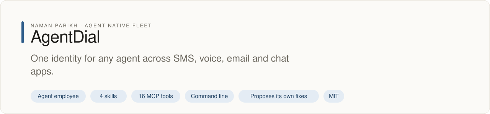

# AgentDial

<!-- fleet:header:start -->
<p align="center"><picture><source media="(prefers-color-scheme: dark)" srcset="assets/banner-dark.svg"></picture></p>

<p align="center">
<a href="https://github.com/naman10parikh/agentdial/actions/workflows/ci.yml"></a>
<a href="https://github.com/naman10parikh/agentdial/releases"></a>
<a href="LICENSE"></a>
<a href="#use-it-from-any-coding-agent"></a>
<a href="https://x.com/naman10parikh"></a>
<a href="https://www.linkedin.com/in/naman-parikh1/"></a>
</p>

<p align="center"><a href="#quick-start">Quick start</a> · <a href="docs/README.md">How it works</a> · <a href="AGENTS.md">AGENTS.md</a> · <a href="llms.txt">llms.txt</a> · <a href="skills/">Skills</a> · <a href="https://github.com/naman10parikh/agentdial/discussions">Discussions</a> · <a href="https://github.com/naman10parikh">All projects</a></p>

**One identity for any agent across SMS, voice, email and chat apps.**

AgentDial is an agent employee, a packaged specialist agent with its own skills, memory and tests. It owns one job: identity. Coding agents use it through its skills, its MCP server and its command line. A scheduled job runs its evals and proposes fixes. A person makes every change.

_AgentDial is part of an agent-native play for agent-native systems that can eventually be recursively self-improving and evolving, operated by agent employees._

<p align="center"></p>
<!-- fleet:header:end -->

[](https://www.npmjs.com/package/agentdial)
[](PROTOCOL.md)
[](https://www.npmjs.com/package/agentdial)

AgentDial gives an AI agent one identity and makes it reachable where people already talk: Telegram,
Discord, Slack, SMS, WhatsApp, email and voice. It is for anyone building an agent who wants people to
message it without wiring a separate API for every platform. One file, `IDENTITY.md`, declares the
agent, and one gateway turns every channel into one message format the agent already understands.

<!-- fleet:use:start -->
## Use it from any coding agent

**Claude Code**: the plugin brings the skills, sub-agents, hooks and MCP server.

```
/plugin marketplace add naman10parikh/agentdial
/plugin install agentdial@agentdial
```

<details><summary>Its MCP server, Codex, Cursor, Gemini CLI, one skill and the command line</summary>

**Its MCP server**, in any MCP client:

```bash
claude mcp add --transport stdio agentdial -- npx -y -p github:naman10parikh/agentdial agentdial-mcp
codex mcp add agentdial -- npx -y -p github:naman10parikh/agentdial agentdial-mcp
```

Cursor (`.cursor/mcp.json`), Gemini CLI (`.gemini/settings.json`) and most other clients take the same command as JSON:

```json
{
  "mcpServers": {
    "agentdial": {
      "command": "npx",
      "args": [
        "-y",
        "-p",
        "github:naman10parikh/agentdial",
        "agentdial-mcp"
      ]
    }
  }
}
```

**Gemini CLI**: the extension brings the context and the MCP server.

```bash
gemini extensions install https://github.com/naman10parikh/agentdial
```

**One skill** (4 in all, in [skills/](skills/)), in any agent that reads Agent Skills:

```bash
gemini skills install https://github.com/naman10parikh/agentdial --path skills/give-agent-identity
git clone --depth 1 https://github.com/naman10parikh/agentdial /tmp/agentdial && cp -r /tmp/agentdial/skills/give-agent-identity ~/.claude/skills/
```

**The command line:**

```bash
npx -y -p github:naman10parikh/agentdial agentdial --help
```

</details>

Codex, Cursor, OpenCode, GitHub Copilot and other agents read [AGENTS.md](AGENTS.md); Claude Code reads [CLAUDE.md](CLAUDE.md) and Gemini CLI reads [GEMINI.md](GEMINI.md), which import it. [llms.txt](llms.txt) maps every surface for agents that read first.
<!-- fleet:use:end -->

## Quick start

Run it straight from GitHub, or install it from npm with `npm install -g agentdial`. It needs Node.js
18 or later and runs on macOS, Linux and Windows (WSL).

```bash
npx -y -p github:naman10parikh/agentdial agentdial --help
```

Try the gateway on your own machine. Any HTTP endpoint that answers `{ "text": "..." }` can be the
agent; here it is a local one on port 8787.

```bash
agentdial serve --agent-url http://localhost:8787/agent
curl -s localhost:3141/health
# {"status":"ok","mode":"proxy","agentUrl":"http://localhost:8787/agent","tunnel":null}
curl -s -X POST localhost:3141/message -H 'content-type: application/json' \
  -d '{"id":"m1","channel":"web","from":"user-1","text":"hello","timestamp":1700000000000}'
# {"text":"echo: hello"}
```

Go live on a real channel. Telegram is free and needs one token from @BotFather:

```bash
agentdial setup                      # create the identity and pick channels
agentdial channels add telegram      # paste the bot token; it is stored outside the project
agentdial serve --agent-url http://localhost:8080/agent --tunnel
```

`setup` shows the identity and every channel's state:

```
  ┌────────────────────────────────────────┐
  │ Agent: Spark                           │
  │ Tagline: Your AI concierge             │
  │ Backend: http://localhost:8080/agent    │
  └────────────────────────────────────────┘

  Channel          Status    Cost     Setup
  ────────────────  ────────  ───────  ─────
  Telegram Bot      active   Free     2 min
  Discord Bot       active   Free     3 min
  Slack App         ready    Free     5 min
  SMS (Twilio)      ----     ~$0.01   5 min
  Voice (Twilio)    ----     ~$0.01   5 min
```

One file. Seven channels. Your agent has an identity. Add more channels any time with
`agentdial channels add <channel>`.

## How it works

**MCP gave agents tools. A2A gave agents collaboration. AIP gives agents identity.** Agents are the new
employees. They need phone numbers, inboxes and handles, not just API keys. Today every platform
reinvents this: Twilio for SMS, Discord.js for chat, the Slack SDK for work, SendGrid for email. That is
fifteen APIs to give one agent a presence. AIP is a protocol, `IDENTITY.md` is the spec, and `agentdial`
is the reference implementation.

| Protocol | Solves              | Spec                          | Reference Impl    |
| -------- | ------------------- | ----------------------------- | ----------------- |
| **MCP**  | Tool access         | Tool schemas (JSON)           | SDK + CLI         |
| **A2A**  | Agent collaboration | Agent Cards (JSON)            | SDK + server      |
| **AIP**  | Agent identity      | `IDENTITY.md` (YAML+Markdown) | SDK + `agentdial` |

AIP defines two primitives:

- **`IDENTITY.md`**: one Markdown file with YAML frontmatter that declares who your agent is, where it
  lives and which channels it speaks on. Human-readable, machine-parseable, portable.
- **`GatewayMessage`**: one message format (`{ id, channel, from, text, timestamp }`) for Telegram,
  Discord, Slack, SMS, WhatsApp, email and voice. Your agent handles one format; AgentDial handles the rest.

```
  Telegram ──┐
  Discord  ──┤                    ┌──────────────────┐
  Slack    ──┤   ┌────────────┐   │                  │
  SMS      ──┼──>│  agentdial │──>│  Your Agent      │
  WhatsApp ──┤   │  Gateway   │   │  Backend         │
  Email    ──┤   │  :3141     │   │  (any HTTP)      │
  Voice    ──┘   └────────────┘   └──────────────────┘
                       │
                       │  GatewayMessage (normalized)
                       │  { id, channel, from, text, timestamp }
                       │
                       │  GatewayResponse (per-channel)
                       │  Telegram: Markdown + inline keyboards
                       │  Discord:  Embeds + components
                       │  Slack:    Blocks + actions
                       └  Others:   Plain text fallback
```

Your agent backend is a plain HTTP endpoint. It receives a JSON `GatewayMessage` and returns
`{ "text": "..." }`. That is the entire contract. Every inbound webhook is checked against its
platform's signature (Twilio HMAC-SHA1, Slack HMAC-SHA256 with replay protection, Telegram secret token),
and every dispatch is appended to a run log with its channel, duration and outcome.

### Channels

| Channel           | Cost        | Setup  | Credentials                |
| ----------------- | ----------- | ------ | -------------------------- |
| Telegram Bot      | Free        | 2 min  | Bot token from @BotFather  |
| Discord Bot       | Free        | 3 min  | Bot token + application ID |
| Slack App         | Free        | 5 min  | Bot token + signing secret |
| SMS (Twilio)      | ~$0.008/msg | 5 min  | Account SID + auth token   |
| WhatsApp (Twilio) | ~$0.005/msg | 10 min | Account SID + auth token   |
| Email (SendGrid)  | Free trial  | 3 min  | API key + verified sender  |
| Voice (Twilio)    | ~$0.013/min | 5 min  | Account SID + auth token   |

Telegram, Discord and Slack need no payment details. Email also works through AgentMail, and voice
through Vapi.

### The IDENTITY.md spec

The **Agent Identity Protocol v1.0** spec is in [PROTOCOL.md](PROTOCOL.md). The YAML frontmatter is
machine-readable; the Markdown body is human-readable context that doubles as a system prompt.

```yaml
---
name: spark
tagline: Your AI concierge
version: "1.0.0"
agent_url: http://localhost:8080/agent
channels:
  telegram:
    enabled: true
    handle: "@spark_bot"
  discord:
    enabled: true
    handle: "Spark#1234"
  slack:
    enabled: true
  web:
    enabled: true
---

# Spark

> Your AI concierge

## Personality

- Friendly and knowledgeable
- Concise but thorough

## Capabilities

- Restaurant recommendations and reservations
- Event discovery and booking

## Boundaries

- No financial transactions
- No medical or legal advice
```

### Voice

```bash
agentdial voice setup
agentdial voice test --number +15551234567
```

Calls are transcribed, routed through the same gateway as chat, and the replies are spoken back
through Twilio.

### Configuration

```
~/.agentdial/
├── config.json          # Gateway port, log level, identity path
├── credentials/         # Per-channel credentials (0600 permissions)
│   ├── telegram.json
│   ├── discord.json
│   └── twilio.json
├── templates/           # Identity file templates
└── logs/                # Gateway logs
```

Credentials never touch your project folder or git, and the plugin's hook stops an agent from reading
them.

### Commands

```
SETUP
  agentdial setup                      Interactive wizard
  agentdial setup --file ./agent.md    Use existing identity file
  agentdial quickstart                 From an API key to a live agent in one flow

CHANNELS
  agentdial channels add <channel>     Add a channel
  agentdial channels remove <channel>  Remove a channel
  agentdial channels list              List all channels
  agentdial channels test [channel]    Test connectivity
  agentdial recipes                    Per-platform setup guides
  agentdial recipes run <channel>      Guided setup for one channel

VOICE
  agentdial voice setup                Configure Twilio voice
  agentdial voice test -n <phone>      Test call

GATEWAY
  agentdial serve                      Start gateway (port 3141)
  agentdial serve -p 8080              Custom port
  agentdial serve -a http://my-agent   Custom backend
  agentdial serve --tunnel             Public HTTPS address for webhooks

STATUS
  agentdial status                     Show channel statuses
  agentdial status --json              Machine-readable output

TEST
  agentdial test                       Test full pipeline
  agentdial test -c telegram -m "hi"   Test specific channel

MCP
  agentdial mcp-serve                  Start as MCP server (also the agentdial-mcp bin)

HARNESS
  agentdial memory-search <query>      Search AgentDial's own knowledge (BM25)
  agentdial sandbox-run "<command>"    Run untrusted code in an E2B microVM, not on the host
```

The 16 MCP tools (`send_message`, `channel_add`, `identity_status` and the rest) are listed in
[AGENTS.md](AGENTS.md).

### Tests

```bash
npm install && npm test    # 79 cases: identity parsing, gateway normalization, response formatting,
                           # adapter compliance, Zod validation, and 21 behavioral evals
npm run eval               # the behavioral evals alone
```

All mocked: no real API calls.

<!-- fleet:anatomy:start -->
## What it is made of

Every project in this fleet is graded on the same 11 harness components and on self-improvement. Each mark is backed by a file you can open.

| Component | Grade | Where |
| --- | --- | --- |
| Identity | 🟡 | identity/SOUL.md:1-7 (self ✅); reachability needs the maintainer's channel credentials and one live round trip |
| Memory | ✅ | memory/MEMORY.md:1; src/lib/memory-index.ts:1 (BM25, `agentdial memory-search`) |
| Skills | ✅ | skills/give-agent-identity/SKILL.md:1 (+3 more in skills/) |
| Tools/CLIs | ✅ | package.json:6-9 (agentdial, agentdial-mcp) |
| Hooks | ✅ | .claude/settings.json:4; hooks/hooks.json:3; hooks/guard-credentials.cjs:1 |
| Sub-agents | ✅ | .claude/agents/channel-adapter-reviewer.md:1; .claude/agents/identity-auditor.md:1 |
| MCPs | ✅ | src/commands/mcp-serve.ts:56 (16 tools); src/mcp.ts:1; .mcp.json:3 |
| Dispatch | ✅ | src/lib/gateway.ts:178 (routeMessage); .github/workflows/improve.yml:8 (daily) |
| Evals | ✅ | eval/behavioral.test.ts:35 (21 cases); .github/workflows/ci.yml:23-24 |
| Observability | ✅ | src/lib/run-log.ts:45 (logs/runs.jsonl on every dispatch) |
| Sandbox/Infra | ✅ | src/lib/sandbox.ts:58 (E2B create, run, kill) |
| Self-improvement | ✅ | dsip.json:1 (L2); scripts/improve.mjs:1 |

✅ real and tested · 🟡 partial, with the reason in the row · ❌ absent
<!-- fleet:anatomy:end -->

<!-- fleet:footer:start -->
## How it improves itself

It carries its own evals and a self-improvement contract, [`dsip.json`](dsip.json), which says what it may change and how a change is judged. A scheduled job runs its evals and proposes fixes. A person makes every change. Lessons it learns are kept as rules in its memory files.

## Part of a fleet

One of the projects by [Naman Parikh](https://github.com/naman10parikh). Each owns one part of an agent's harness, or of the product around an agent, and all of them follow one standard.

| Related project | What it owns |
| --- | --- |
| [WikiMem](https://github.com/naman10parikh/wikimem) | Memory |
| [Skillsmith](https://github.com/naman10parikh/skillsmith) | Skills |
| [Agent Booster](https://github.com/naman10parikh/agent-booster) | Tools / CLIs |
| [Armory](https://github.com/naman10parikh/armory) | MCPs and the component registry |
| [AgentGrid](https://github.com/naman10parikh/agentgrid) | Dispatch |
| [AgentSwarm](https://github.com/naman10parikh/agentswarm) | Dispatch |
| [AgentBench](https://github.com/naman10parikh/agentbench) | Evals |
| [AgentMoney](https://github.com/naman10parikh/agentmoney) | Observability |
| [Claude Harness](https://github.com/naman10parikh/claude-harness) | The whole harness, as a template |

## Community

Questions and ideas go to [Discussions](https://github.com/naman10parikh/agentdial/discussions); bugs go to [issues](https://github.com/naman10parikh/agentdial/issues/new/choose). Follow the work on [X](https://x.com/naman10parikh) and [LinkedIn](https://www.linkedin.com/in/naman-parikh1/).

## Contributing and security

Read [CONTRIBUTING.md](CONTRIBUTING.md). AI-assisted pull requests are welcome. Report a vulnerability privately, as [SECURITY.md](SECURITY.md) explains.

## Star history

If it is useful to you, a star helps other people find it.

<a href="https://star-history.com/#naman10parikh/agentdial&Date"><picture><source media="(prefers-color-scheme: dark)" srcset="https://api.star-history.com/svg?repos=naman10parikh/agentdial&type=Date&theme=dark"></picture></a>

## Contributors

<a href="https://github.com/naman10parikh/agentdial/graphs/contributors"></a>
<!-- fleet:footer:end -->

## License

MIT, © 2026 Naman Parikh. See [LICENSE](LICENSE).
