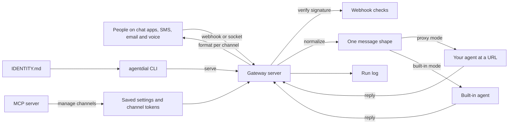

# How AgentDial works

AgentDial gives one AI agent a single identity that people can reach on Telegram, Discord, Slack, SMS, WhatsApp, email and voice.
It is a command-line tool plus a gateway, a small web server that sits between the platforms and your agent.
The gateway turns every platform's message into one shape and sends it to your agent.
It then turns the reply back into each platform's own format.
It is for developers who already have an agent and want people to reach it without writing one integration per platform.
The two shared formats, `IDENTITY.md` and `GatewayMessage`, are written down in [PROTOCOL.md](../PROTOCOL.md) as the Agent Identity Protocol.

## The parts

Everything starts in [src/index.ts](../src/index.ts), which defines the commands.
Each command lives in [src/commands/](../src/commands/) and loads only when it runs.
Your agent's name, tagline and channels sit in the YAML front matter of an `IDENTITY.md` file.
[src/lib/identity.ts](../src/lib/identity.ts) reads that file and checks it against the schema in [src/adapters/types.ts](../src/adapters/types.ts).
[src/lib/config.ts](../src/lib/config.ts) saves settings to `~/.agentdial/config.json`.
[src/lib/credentials.ts](../src/lib/credentials.ts) saves each channel's tokens to its own file under `~/.agentdial/credentials/`, readable only by you.

The gateway is [src/commands/serve.ts](../src/commands/serve.ts).
It checks webhook signatures with [src/lib/webhook-validation.ts](../src/lib/webhook-validation.ts).
[src/lib/gateway.ts](../src/lib/gateway.ts) turns each payload into one `GatewayMessage` and shapes each reply for its platform.
The reply comes from your own agent at a URL, or from the built-in agent.
The built-in agent in [src/lib/built-in-agent.ts](../src/lib/built-in-agent.ts) calls the Anthropic or OpenAI API.
Discord and Slack connect over a live socket through the classes in [src/adapters/](../src/adapters/).
[src/lib/run-log.ts](../src/lib/run-log.ts) appends a timed record of each message sent to your agent's URL.
The same operations are open to coding agents through the MCP server in [src/commands/mcp-serve.ts](../src/commands/mcp-serve.ts).
MCP, the Model Context Protocol, is the standard way an agent calls outside tools.

## What happens when you run it

The main flow is `agentdial serve`, which starts the gateway.

1. [src/index.ts](../src/index.ts) parses the command and loads [src/commands/serve.ts](../src/commands/serve.ts).
2. `serve` loads your settings with [src/lib/config.ts](../src/lib/config.ts) and reads `IDENTITY.md` with [src/lib/identity.ts](../src/lib/identity.ts).
3. It picks the agent. A `--agent-url` flag or a saved URL means proxy mode. Otherwise it starts the built-in agent from `~/.agentdial/agent.json`, or from an `ANTHROPIC_API_KEY` or `OPENAI_API_KEY` variable. The body of `IDENTITY.md` becomes the built-in agent's system prompt.
4. With `--tunnel`, [src/lib/tunnel.ts](../src/lib/tunnel.ts) opens a public URL through cloudflared or localtunnel. The gateway then registers its webhook with Telegram and Twilio for you.
5. The server listens on port 3141 by default. It offers `POST /webhook/:channel`, `POST /message` and `GET /health`. If Discord or Slack tokens are saved, it also connects those bots over a socket.
6. A webhook body may be up to 1 MB. If the channel's secret is saved, the Twilio, Slack or Telegram signature must match, or the request gets a 403.
7. `normalizeMessage` in [src/lib/gateway.ts](../src/lib/gateway.ts) turns the payload into a `GatewayMessage` with an id, channel, sender, text and time.
8. In proxy mode, `routeMessage` posts that message to your agent and waits up to 30 seconds. [src/lib/run-log.ts](../src/lib/run-log.ts) appends the timing and outcome to `logs/runs.jsonl`.
9. In built-in mode, [src/lib/built-in-agent.ts](../src/lib/built-in-agent.ts) answers instead. It keeps the last 20 exchanges per sender in memory.
10. `formatResponse` shapes the reply: buttons for Telegram, embeds for Discord, blocks for Slack. SMS, WhatsApp and voice replies go back as TwiML, the XML format Twilio reads.

## Extending it

The repository ships skills, step-by-step guides a coding agent can follow, for its most common changes.
They live in [skills/](../skills/), and the Claude Code plugin in [.claude-plugin/](../.claude-plugin/) loads them.

- **A new channel.** Follow [skills/add-channel-adapter/SKILL.md](../skills/add-channel-adapter/SKILL.md). Add the channel id to `ChannelTypeSchema` in [src/adapters/types.ts](../src/adapters/types.ts) and to the maps in [src/lib/constants.ts](../src/lib/constants.ts). Extend `normalizeMessage` and `formatResponse` in [src/lib/gateway.ts](../src/lib/gateway.ts). For a webhook platform, add a signature check to [src/lib/webhook-validation.ts](../src/lib/webhook-validation.ts) and call it from `validateWebhook` in [src/commands/serve.ts](../src/commands/serve.ts). A full adapter class goes in [src/adapters/](../src/adapters/) and is registered in [src/adapters/index.ts](../src/adapters/index.ts). Add an inbound and an outbound case to [eval/behavioral.test.ts](../eval/behavioral.test.ts).
- **A new MCP tool.** Follow [skills/add-mcp-tool/SKILL.md](../skills/add-mcp-tool/SKILL.md). Add an entry to the `TOOLS` list in [src/commands/mcp-serve.ts](../src/commands/mcp-serve.ts) and a case in `handleToolCall`. The handler should reuse the code that the matching CLI command calls.
- **A new command.** Register it in [src/index.ts](../src/index.ts) with a lazy import of a new file in [src/commands/](../src/commands/).
- **A new setup recipe.** A recipe is a guided setup for one channel, with its cost and a friction tier from 0 to 4. Add a file in [src/recipes/](../src/recipes/) and register it in [src/recipes/index.ts](../src/recipes/index.ts).
- **A new skill.** Add `skills/<name>/SKILL.md` and list it in [skills/README.md](../skills/README.md).

Then run `npm run build`, `npm test` and `npm run eval`.
If the eval pass count goes up, raise `evals_passed` in [eval/baseline.json](../eval/baseline.json).

## Questions

**Does it need an API key or cost money?**
AgentDial itself is free and MIT licensed.
It needs no model key if you point it at your own agent's URL.
The built-in agent needs an Anthropic or OpenAI API key, and that provider bills you.
Each platform needs its own bot token or account.
Telegram, Discord and Slack are free.
SMS and voice go through Twilio, which charges for the number and the minutes.
[src/lib/constants.ts](../src/lib/constants.ts) lists an estimated cost for every channel.
The `sandbox-run` command needs an E2B key.

**Does any data leave the machine?**
Yes, because relaying messages is its job.
Messages arrive from each platform, and replies go back to it.
In proxy mode each message goes to your agent's URL.
In built-in mode the conversation goes to the Anthropic or OpenAI API.
Tokens stay on your machine in `~/.agentdial/credentials/`, one file per channel, with owner-only permissions.
The plugin hook [hooks/guard-credentials.cjs](../hooks/guard-credentials.cjs) stops a coding agent from reading those files.
The `--tunnel` flag exposes the local port through cloudflared or localtunnel.
The optional `login` command talks to a hosted account service set in [src/lib/auth.ts](../src/lib/auth.ts).

**How does it improve itself?**
[dsip.json](../dsip.json) puts it at level L2, which means a scheduled loop runs and writes proposals.
Every day [.github/workflows/improve.yml](../.github/workflows/improve.yml) runs [scripts/improve.mjs](../scripts/improve.mjs).
The script runs the evals and compares the pass count with [eval/baseline.json](../eval/baseline.json).
It also lists outdated dependencies, then writes a proposal to `logs/improve/latest.md`.
The workflow then opens one issue labelled `proposal`, or updates the one already open, so a person can review it.
It uses no model and no secret, and a person merges every change.
It is not L3, because the loop does not change its own steps.

**How do I run its tests or evals?**
Run `npm install`, then `npm run build` and `npm test`.
`npm test` runs the unit tests in [src/\_\_tests\_\_/](../src/__tests__/) and the evals in [eval/](../eval/).
`npm run eval` runs only the behavioral cases in [eval/behavioral.test.ts](../eval/behavioral.test.ts).
The evals are mocked and need no network.
`npm run improve` runs the improvement loop on your machine.

**What does it not do?**
It does not build or host your agent.
It only carries messages to it and back.
`imessage` and `web` are channel names, but neither has an adapter yet.
Both are planned, so `channels add` enables nothing for them.
The `web` channel is the plain `POST /message` endpoint.
The built-in agent keeps history in memory only, so a restart forgets every conversation.
To run a command an agent asks for, `sandbox-run` uses an E2B sandbox, a short-lived virtual machine, instead of your computer.

## More

- [recipes/email-sendgrid.md](recipes/email-sendgrid.md): give the agent an email address through SendGrid.
- [recipes/voice-twilio.md](recipes/voice-twilio.md): give the agent a phone number through Twilio.
